# Memento (fork)

A fork of [Memento](https://github.com/ripose-jp/Memento) by ripose-jp: a free,
mpv-based video player for learning Japanese. Hover a word in the subtitles,
a dictionary popup appears, and one click makes an Anki card with the
sentence, audio and a screenshot.

This fork turns it into an all-in-one immersion app: a Netflix-style library
for your anime, a manga reader with the same hover lookups (via
[mokuro](https://github.com/kha-white/mokuro)), MyAnimeList and Toggl
tracking, and a card builder. Windows builds only.

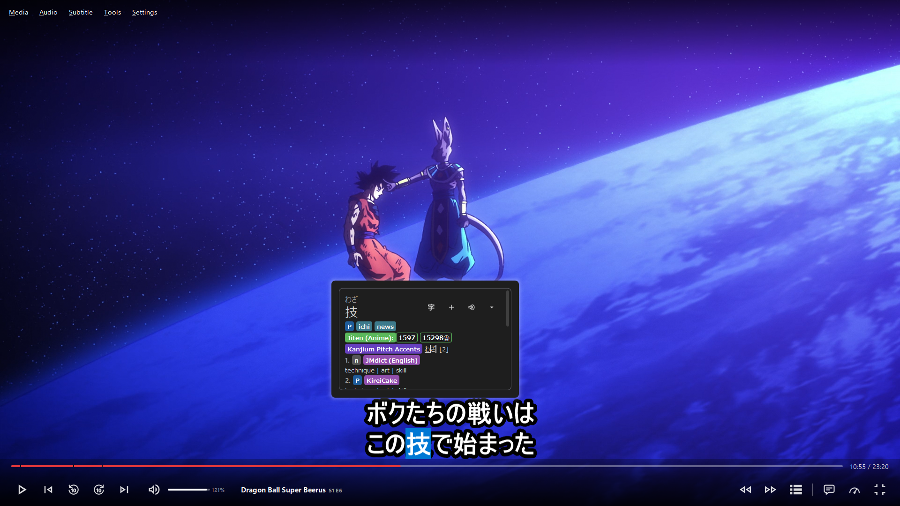

> Based on Memento by ripose-jp, licensed under the
> [GNU GPL v2](LICENSE). This fork is not affiliated with the original
> project; please report problems with fork features
> [here](https://github.com/Sinovexx-TM/Memento/issues), not upstream.

## Contents

- [Download](#download)
- [What this fork adds](#what-this-fork-adds)
  - [Watching](#watching)
  - [Lookups and Anki cards](#lookups-and-anki-cards)
  - [Library](#library)
  - [Tracking: Toggl and MyAnimeList](#tracking-toggl-and-myanimelist)
  - [Manga](#manga)
  - [Subtitles](#subtitles)
- [Setup](#setup)
- [File names](#file-names)
- [Where your data is stored](#where-your-data-is-stored)
- [Known limits](#known-limits)
- [From the original Memento](#from-the-original-memento)

## Download

Get the latest installer (`Memento_Windows_x86_64_Installer.exe`) or the
portable zip from the [Releases](https://github.com/Sinovexx-TM/Memento/releases)
page.

## What this fork adds

### Watching

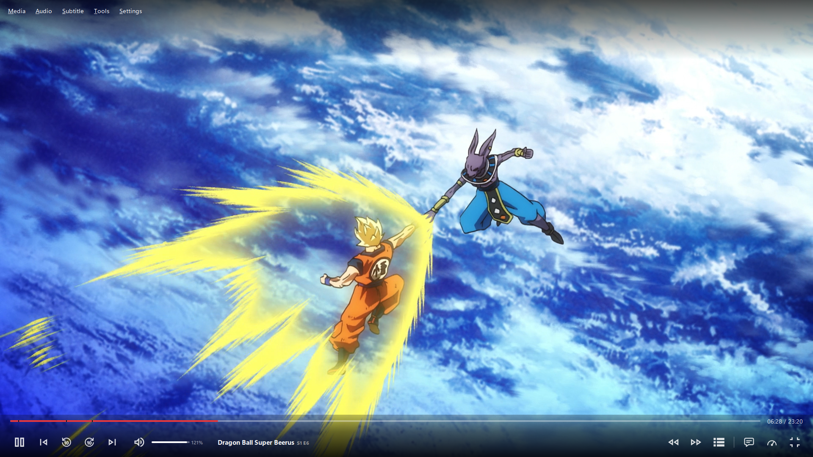

- **Netflix-style controls**: thin red progress bar with chapter marks and
  hover time; play/pause, previous/next file, back/forward 10 s, volume,
  previous/next subtitle line, subtitle list, tracks, fullscreen; the show
  and episode ("Show E9") in the control bar. The classic controls are still
  a setting.
- **Pause screen**: pause for a few seconds and the screen shows what you're
  watching (show, episode, file name), with a ← back to the Library. Pauses
  from hovering subtitles don't trigger it.

  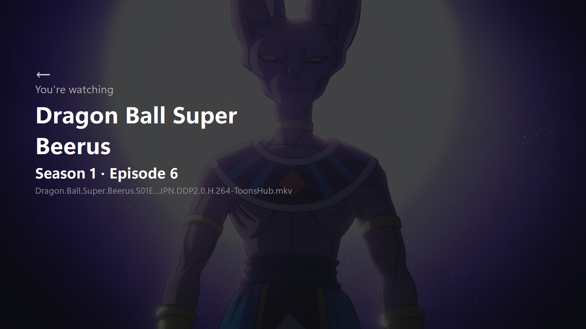

- **Arrow keys**: ← / → jump a few seconds (you choose how many) or one
  subtitle line (Settings > Behavior). Seeking is frame-exact, so rewinding
  doesn't snap back.
- **Clean titles**: `[Group] Show - 13 (BD 1080p).mkv` shows as
  "Show · Episode 13" everywhere (see [File names](#file-names)).

### Lookups and Anki cards

- **Pause on hover**: the video pauses while your cursor is on the subtitles
  and resumes when it leaves (with a short delay, so a slip doesn't restart
  playback).
- **Card builder**: before a card is added, a dialog lets you step to the
  previous/next subtitle line, trim the audio on a waveform, and play the
  selection or the full clip.

  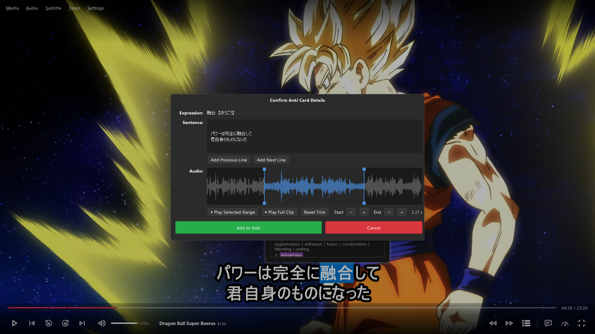

- **Pitch-accent graph** on Anki cards, in Yomitan's style (put the
  `{pitch-graphs}` marker in a card field; needs a pitch dictionary).

- **Better deconjugation**: forms the original missed (〜たら, ちゃ/じゃ,
  〜けりゃ, 書かされる, slang like 高え/すげえ).
- Cleaner popup frame; the popup opens on the first hover and closes shortly
  after the cursor leaves.

### Library

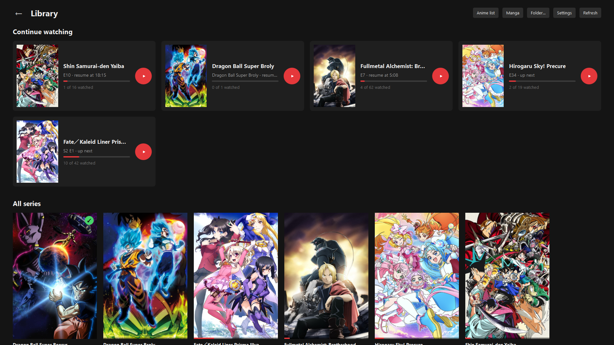

- **Media > Library…** (also shown when Memento starts without a video).
  Point it at your anime folder: one folder per series; seasons (S1, S2…)
  and extras (NCOP, specials, menus…) get their own sections; loose files
  are grouped by show name.
- **Continue watching** and a **poster grid** (posters from AniList, fetched
  automatically; progress strip; ✓ for finished shows).
- **Series pages**: Resume/Play, rename, change poster, episode list with
  watched ticks and "UP NEXT", "Mark watched up to here".

  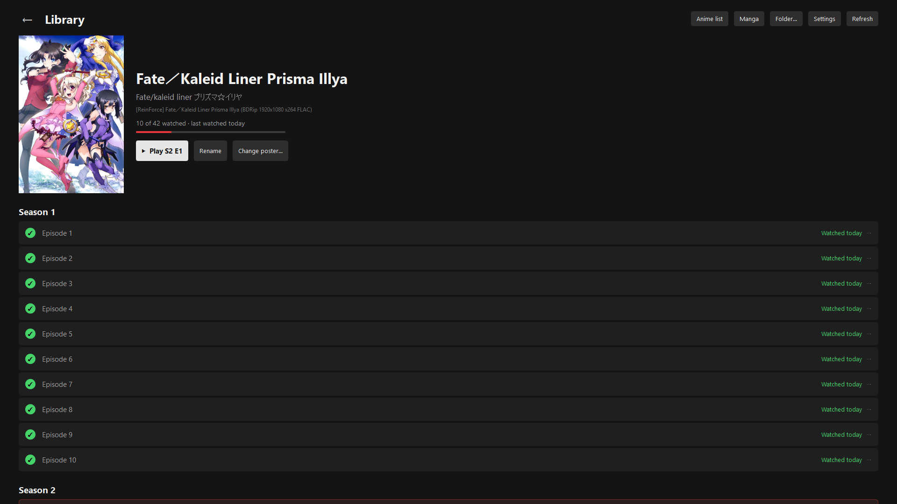

- **Watch history**: your position is saved as you watch; an episode counts
  as watched when it reaches its ending (and stays watched if you delete the
  file). Playing from the Library queues only that show's episodes.

### Tracking: Toggl and MyAnimeList

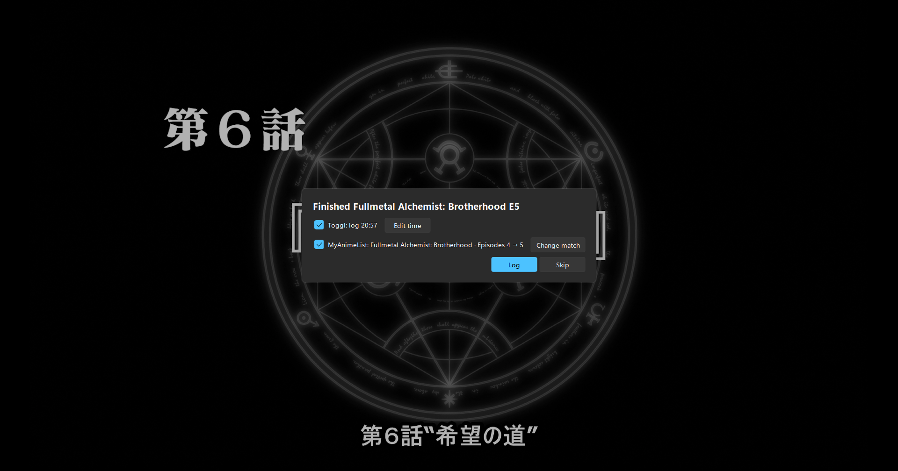

- **End-of-episode prompt**: when an episode reaches its ending, Memento
  offers to
  - log the time you watched to **Toggl** (without the opening and ending),
    and
  - update your **MyAnimeList** progress ("Episodes 13 → 14", Completed on
    the last one).

  Tick what you want and press Log. Anything that fails to send is kept and
  retried.
- **Anime list**: your MAL list inside Memento, with covers, tabs
  (Watching, Plan to Watch, …), −/+1, status menu and a link to MAL.

  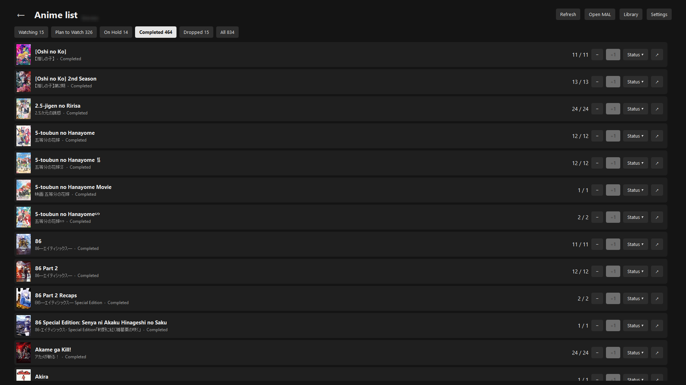

- Everything is configurable in Settings > Behavior: Toggl token, workspace,
  project, tags and description (`{show} E{episode}` by default); MAL login.

### Manga

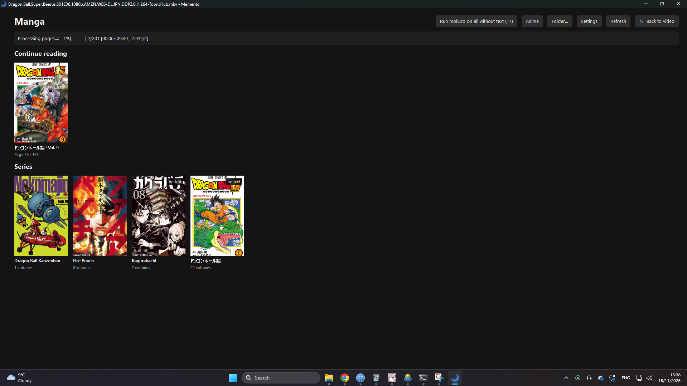

- **Manga page** (Library > Manga, or Media > Manga…): your manga folder,
  with "Continue reading", a series grid and per-volume progress.
- **Runs mokuro for you**: volumes without text show a badge; run mokuro on
  one volume or on all of them from inside Memento, with a progress bar and
  Cancel. No terminal needed (see [Setup](#setup)).

  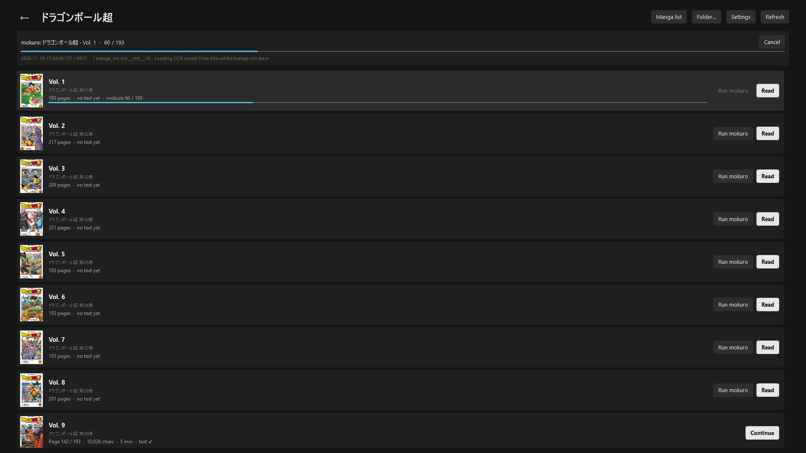

- **Reader**: right-to-left pages, one or two pages at a time (D). Hover a
  speech bubble for the dictionary popup. Click the page to zoom in on that
  spot (again to zoom out), use the wheel to zoom, drag to move. Click the
  dark edge on the left or press ← for the next page; the right edge or → to
  go back.

  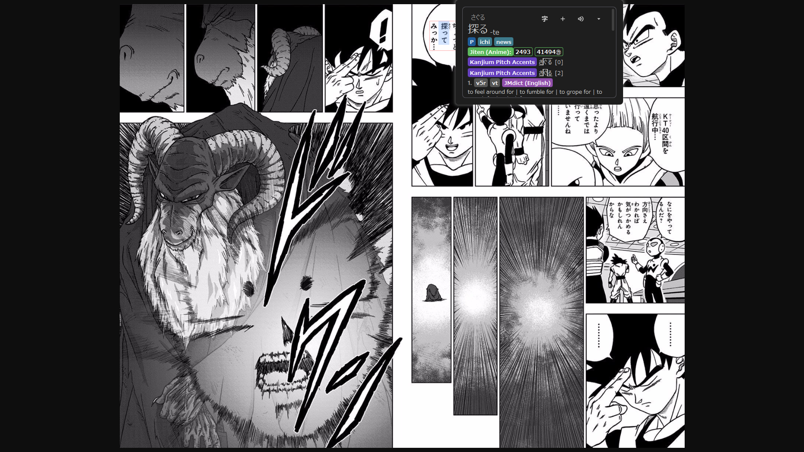

- **Cards from manga** use the whole page as the picture and are tagged
  `Manga::<series>`.
- **Reading sessions**: active time, pages and characters read are logged to
  `manga_sessions.csv`, and Memento offers to log the session to Toggl when
  you close a volume. Closing the app mid-volume doesn't lose the session.
- **Manga list**: your MAL manga list, with separate chapter and volume
  counters.

  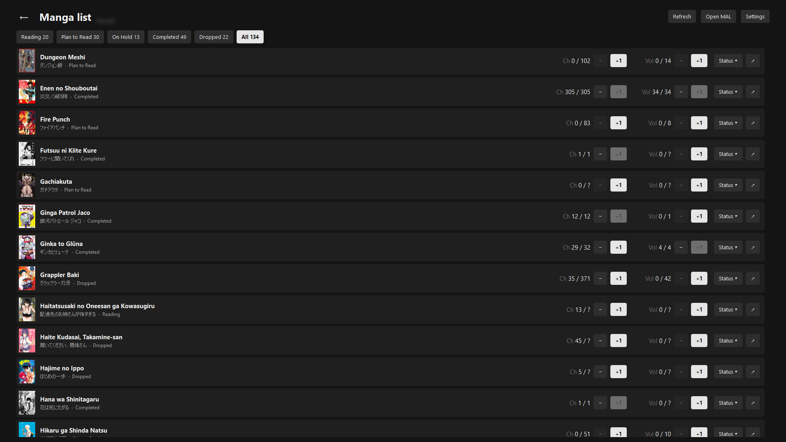

### Subtitles

- **Automatic subtitle matching**: opening a video with no Japanese subtitle
  finds the matching subtitle file in the folder (or a `subs` subfolder) by
  episode number and loads it; asks when unsure.
- **Subtitle > Match Subtitles in This Folder**: renames subtitle files to
  match their videos, after showing you a preview. Never overwrites.

## Setup

Memento needs dictionaries and Anki like the original; see
[Dictionaries](#dictionaries) and install
[AnkiConnect](https://ankiweb.net/shared/info/2055492159) in Anki. Then, for
the fork's features:

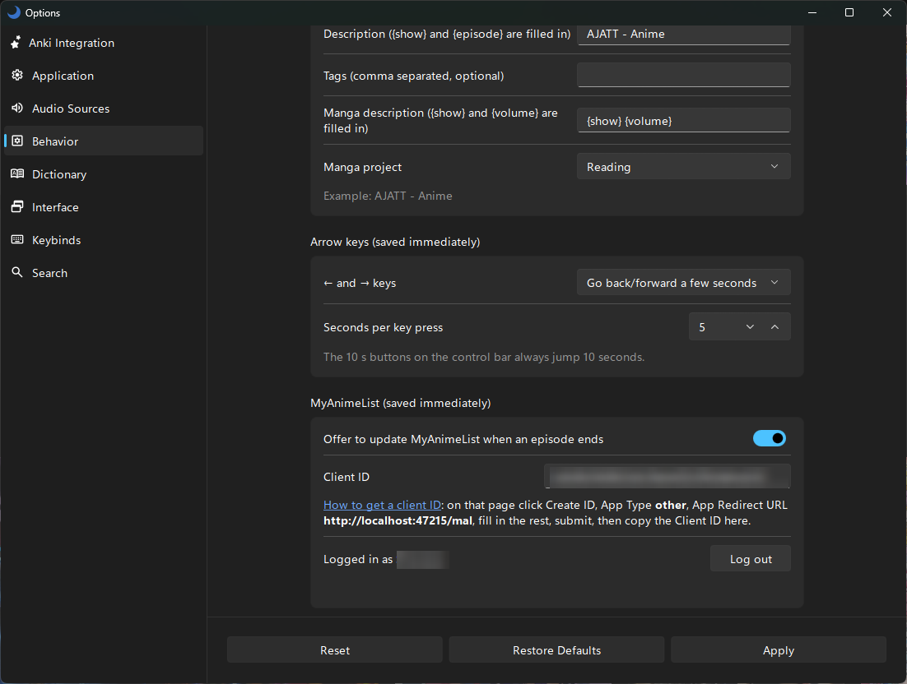

1. **Anime folder**: Media > Library… > Folder…, pick the folder that holds
   one folder per series.
2. **Manga folder**: Library > Manga > Folder…. Each volume must be a
   folder of page images (`.cbz`/`.rar` archives aren't read yet; extract
   them).
3. **MyAnimeList** (optional): you need your own free client ID.
   1. Go to [myanimelist.net/apiconfig](https://myanimelist.net/apiconfig)
      and create an app.
   2. App Type: **other**. App Redirect URL:
      `http://localhost:47215/mal`. The other fields can be anything.
   3. Copy the Client ID into Settings > Behavior > MyAnimeList and press
      **Log in**. Your browser opens MAL's login page once.
4. **Toggl** (optional): paste your API token (Toggl > Profile settings) into
   Settings > Behavior > Toggl, then pick a workspace and project.

   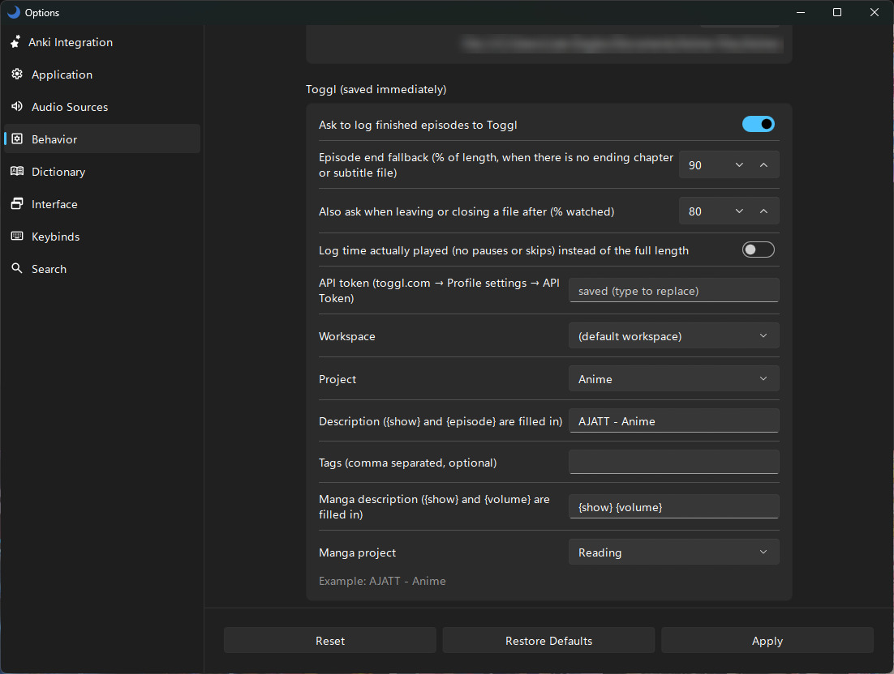

5. **mokuro** (optional, for manga text):
   1. Install [Python](https://www.python.org/downloads/) (3.10 or newer;
      tick "Add to PATH").
   2. On the Manga page, open Settings and press **Install mokuro**. The
      first install downloads a few GB of OCR models.
   3. A graphics card makes it much faster; on a CPU, a volume can take a
      long time.

## File names

The name parser understands the usual release styles. These all work:

| File | Shows as |
|---|---|
| `[SubsPlease] Sousou no Frieren - 12 (1080p) [ABCD1234].mkv` | Sousou no Frieren · Episode 12 |
| `Spy.x.Family.S02E10.1080p.CR.WEB-DL.mkv` | Spy x Family · Season 2 · Episode 10 |
| `[VCB-Studio] Fate Zero [01][Ma10p_1080p].mkv` | Fate Zero · Episode 1 |
| `[Anime Time] One Piece - 1085 [1080p].mkv` | One Piece · Episode 1085 |
| `[Group] Show - 12.5 [1080p].mkv` | Show · Episode 12.5 |
| `ドラゴンボール超 第05話.mkv` | ドラゴンボール超 · Episode 5 |
| `Kizumonogatari Part 2 Nekketsu (2016) [BD 1080p].mkv` | Kizumonogatari Part 2 Nekketsu (movie) |
| `Your.Name.2016.1080p.BluRay.x264.mkv` | Your Name (movie) |
| `Fullmetal Alchemist Brotherhood/01.mkv` | Fullmetal Alchemist Brotherhood · Episode 1 (name from the folder) |

Tips:
- Keep **one folder per series**: the Library uses the folder name as the
  title.
- Movies are recognised by a year in the name (`(2016)` or `.2016.`). A
  movie without a year that has a number in its title may show as an
  episode.
- If a name still comes out wrong, use **Rename** on the series page.

## Where your data is stored

Everything stays on your PC, in `%LOCALAPPDATA%\memento`: watch history,
posters and covers, manga progress and `manga_sessions.csv`, your MAL login,
Toggl token and Anki settings. mokuro writes a `<volume>.mokuro` file next to
each volume folder. Nothing is sent anywhere except to the services you set
up (AniList for posters, MyAnimeList, Toggl).

## Known limits

- Windows builds only (the code is cross-platform, but only Windows is built
  and tested).
- Video OCR is not included in these builds; manga text comes from mokuro.
- Manga archives (`.cbz`, `.rar`) aren't supported yet.
- Subtitles built into an `.mkv` only list the lines already played, so
  jumping by subtitle line works best with external subtitle files.

---

## From the original Memento

Everything below is from the upstream README and still applies.

### Features

* Grammar aware subtitle search
* Yomichan-style Kanji cards
* Support for Yomichan dictionaries
* Anki card creation through [AnkiConnect](https://ankiweb.net/shared/info/2055492159)
* Support for mpv upscalers, plugins, and configuration files

### Dictionaries

* [JMdict](https://github.com/yomidevs/jmdict-yomitan/) (English)
  * [JMdict_english_with_examples.zip](https://github.com/yomidevs/jmdict-yomitan/releases/latest/download/JMdict_english_with_examples.zip)
    * This is the version of JMdict with example sentences from the [Tatoeba Project](http://tatoeba.org/home).
  * [JMdict_english.zip](https://github.com/yomidevs/jmdict-yomitan/releases/latest/download/JMdict_english.zip)
    * This is the same JMdict but without example sentences.
  * [JMdict_english_legacy.zip](https://github.com/yomidevs/jmdict-yomitan/releases/latest/download/JMdict_english_legacy.zip)
    * This is the same JMdict with legacy formatting instead of structured content.
  * [JMdict_english_without_proper_names.zip](https://github.com/yomidevs/jmdict-yomitan/releases/latest/download/JMdict_english_without_proper_names.zip)
    * This is `JMdict_english` but without several thousand entries from JMnedict.
  * [JMdict_english_legacy_without_proper_names.zip](https://github.com/yomidevs/jmdict-yomitan/releases/latest/download/JMdict_english_legacy_without_proper_names.zip)
* [JMdict](https://github.com/yomidevs/jmdict-yomitan/) (Other Languages)
  * [JMdict_dutch.zip](https://github.com/yomidevs/jmdict-yomitan/releases/latest/download/JMdict_dutch.zip)
  * [JMdict_french.zip](https://github.com/yomidevs/jmdict-yomitan/releases/latest/download/JMdict_french.zip)
  * [JMdict_german.zip](https://github.com/yomidevs/jmdict-yomitan/releases/latest/download/JMdict_german.zip)
  * [JMdict_hungarian.zip](https://github.com/yomidevs/jmdict-yomitan/releases/latest/download/JMdict_hungarian.zip)
  * [JMdict_russian.zip](https://github.com/yomidevs/jmdict-yomitan/releases/latest/download/JMdict_russian.zip)
  * [JMdict_slovenian.zip](https://github.com/yomidevs/jmdict-yomitan/releases/latest/download/JMdict_slovenian.zip)
  * [JMdict_spanish.zip](https://github.com/yomidevs/jmdict-yomitan/releases/latest/download/JMdict_spanish.zip)
  * [JMdict_swedish.zip](https://github.com/yomidevs/jmdict-yomitan/releases/latest/download/JMdict_swedish.zip)
* [Jitendex](https://jitendex.org/) (English)
  * [jitendex-yomitan.zip](https://github.com/stephenmk/stephenmk.github.io/releases/latest/download/jitendex-yomitan.zip)
    * Similar to `JMdict_english_with_examples` with additional formatting.
* [JMnedict](https://github.com/yomidevs/jmdict-yomitan/) (Japanese Names)
  * [JMnedict.zip](https://github.com/yomidevs/jmdict-yomitan/releases/latest/download/JMnedict.zip)
* [JPDB](https://github.com/Kuuuube/yomitan-dictionaries) (Frequency)
  * [JPDB v2.2 Kana](https://github.com/Kuuuube/yomitan-dictionaries/raw/main/dictionaries/JPDB_v2.2_Frequency_Kana_2024-10-13.zip) (Recommended)
  * [JPDB v2.2 Frequency Kana Display Only](https://github.com/Kuuuube/yomitan-dictionaries/raw/main/dictionaries/JPDB_v2.2_Frequency_Kana_Display_Only_2024-10-13.zip)
  * [JPDB v2.2](https://github.com/Kuuuube/yomitan-dictionaries/raw/main/dictionaries/JPDB_v2.2_Frequency_2024-10-13.zip)
* [BCCWJ SUW LUW Combined](https://github.com/Kuuuube/yomitan-dictionaries) (Frequency)
  * [BCCWJ_SUW_LUW_combined.zip](https://github.com/Kuuuube/yomitan-dictionaries/raw/main/dictionaries/BCCWJ_SUW_LUW_combined.zip)
* Kanjium (Pitch)
  * [kanjium_pitch_accents.zip](https://github.com/FooSoft/yomichan/raw/dictionaries/kanjium_pitch_accents.zip)
* [KANJIDIC](https://github.com/yomidevs/jmdict-yomitan/) (Kanji)
  * [KANJIDIC_english.zip](https://github.com/yomidevs/jmdict-yomitan/releases/latest/download/KANJIDIC_english.zip)
  * [KANJIDIC_french.zip](https://github.com/yomidevs/jmdict-yomitan/releases/latest/download/KANJIDIC_french.zip)
  * [KANJIDIC_portuguese.zip](https://github.com/yomidevs/jmdict-yomitan/releases/latest/download/KANJIDIC_portuguese.zip)
  * [KANJIDIC_spanish.zip](https://github.com/yomidevs/jmdict-yomitan/releases/latest/download/KANJIDIC_spanish.zip)

### Troubleshooting

#### Can't Add Cards: Only the "Show in Anki" Button is Available

This means there is a mistake in your card template.
When this happens, AnkiConnect will report that all potential cards are not addable.
Double check your card template to see if the front of the card is missing something.

#### Windows: Updating yt-dlp

If your version of yt-dlp is out of date, you may experience degraded streaming performance or websites not working entirely.

Memento's version of yt-dlp can be updated by doing the following:

1. Download [yt-dlp](https://github.com/yt-dlp/yt-dlp/releases/latest/download/yt-dlp.exe)
1. Put `yt-dlp.exe` in Memento's install directory. For the portable version of Memento, this is located in the same folder as the executable. For the installed version, this is located at `C:\Program Files\Memento` by default.

### Configuration

Most mpv shaders, plugins, and configuration files will work without modification.

It is important to note that mpv and Memento's configuration directories are
**separate**. This means mpv configuration files, scripts, etc. intended to modify
Memento's behavior should be placed in Memento's configuration directory:

```
%LOCALAPPDATA%\memento
```

If any mpv binds or plugins do not work, please create an issue in the issue
tracker.

### Building

This fork is built for Windows by GitHub Actions
(`.github/workflows/windows-build.yml`), which produces the installer and a
portable zip. To build it yourself, follow the original
[build instructions](https://github.com/ripose-jp/Memento#building), cloning
this repository instead.

### Dependencies

* Qt 6.10 or greater
    * Base
    * SVG
* mpv
* sqlite3
* Json-C
* libzip
* QCoro (optional)
    * Use `-DMEMENTO_SYSTEM_QCORO=ON`
* yt-dlp (optional)
* MeCab (optional)
    * Use `-DMEMENTO_MECAB_SUPPORT=ON`

For the best experience, install [Noto Sans CJK JP](https://github.com/googlefonts/noto-cjk/raw/main/Sans/Variable/TTF/NotoSansCJKjp-VF.ttf)
and the [Kanji Stroke Order](https://drive.google.com/uc?export=download&id=1oyQoTB531tbhlYaOW7ugvutXZ7HSlJfW) fonts.

### Acknowledgements

* Memento by ripose-jp and contributors
  * https://github.com/ripose-jp/Memento
* MpvWidget code is based off of libmpv example code
  * https://github.com/mpv-player/mpv-examples/tree/master/libmpv/qml
* Some code based off of Baka-MPlayer
  * https://github.com/u8sand/Baka-MPlayer
* UI inspired by Yomichan / Yomitan
  * https://github.com/FooSoft/yomichan
* Icons sourced from Google Material Symbols and Icons
  * https://fonts.google.com/icons
* Manga text by mokuro and manga-ocr (kha-white and contributors)
  * https://github.com/kha-white/mokuro
  * https://github.com/kha-white/manga-ocr
* Posters from AniList; lists from the MyAnimeList API; time tracking via the Toggl API
* `mingw-bundledlls.py` based on this script with a slightly expanded blacklist
  * https://github.com/mpreisler/mingw-bundledlls
* QCoro is builtin to the project
  * https://github.com/qcoro/qcoro
* Most dictionary links taken from jmdict-yomitan and yomitan-dictionaries
  * https://github.com/yomidevs/jmdict-yomitan
  * https://github.com/Kuuuube/yomitan-dictionaries
